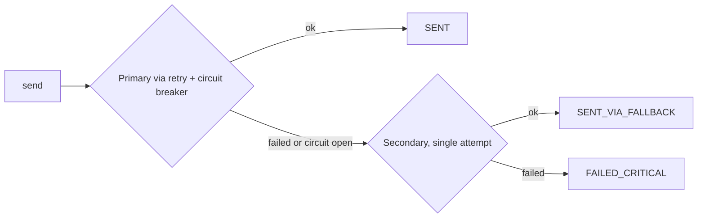

# Runbook: provider failover and provider outage

## Background

`ResilientNotificationProviderAdapter` is the only `NotificationProviderPort` used for delivery.
For every send it:

1. Calls the **primary** provider for the channel, inside retry (3 attempts, transient errors
   only) and the channel's circuit breaker.
2. On any primary failure, or when the circuit is open and the call is rejected, immediately calls
   the **secondary** provider once.
3. Reports the outcome:
   - primary succeeded: `SENT`
   - secondary succeeded: `SENT_VIA_FALLBACK` (and increments `aegisnotify.fallback.transmissions`)
   - secondary also failed: `FAILED_CRITICAL`

Facts that shape operations:

- The **secondary has no circuit breaker and no retry**. The Providers screen shows it with state
  `NOT_PROTECTED` ("NO CIRCUIT").
- The secondary is optional. If its credentials are blank, `ProviderConfig` substitutes a stub that
  always fails with code `NOT_CONFIGURED` and detail "No secondary provider configured for channel
  <CHANNEL>". Startup is not blocked. In that state every primary failure becomes `FAILED_CRITICAL`.
- Primary credentials are mandatory and the service refuses to start if they are blank
  (`SENDGRID_API_KEY` when the email vendor is `sendgrid`, `TWILIO_ACCOUNT_SID`/`TWILIO_AUTH_TOKEN`,
  `FCM_PROJECT_ID`/`FCM_ACCESS_TOKEN`, or the Vonage variables when the WhatsApp vendor is
  `vonage`). The `docker-compose.full.yml` stack supplies `local-placeholder` values, so there the
  service starts and real sends fail.
- Secondary variables use the `*_SECONDARY_*` names, for example `SENDGRID_SECONDARY_API_KEY`,
  `TWILIO_SECONDARY_ACCOUNT_SID`, `TWILIO_SECONDARY_AUTH_TOKEN`, `FCM_SECONDARY_PROJECT_ID`,
  `FCM_SECONDARY_ACCESS_TOKEN`. By default the secondary base URL equals the primary's, so a
  secondary is typically a second *account* at the same vendor, which does not protect against a
  vendor-wide outage.

## Symptom

- Fallback activations rise (Dashboard "Fallback activations", Metrics "Fallback transmissions").
- Notifications finish as `SENT_VIA_FALLBACK` instead of `SENT`.
- Optionally, `FAILED_CRITICAL` appears when the secondary is also unavailable or unconfigured.
- Circuit breaker for the channel is `OPEN` ([runbook 01](01-circuit-breaker-open.md)); this is
  the common cause but not required, since a single failed primary call already triggers failover.

## Detection

| Signal | Where |
| --- | --- |
| Fallback count (24h, with delta vs previous 24h) | `GET /api/v1/dashboard/summary` field `fallbackActivations`; Admin UI `/dashboard` |
| Fallback count (since service start) | Admin UI `/metrics` "Fallback transmissions"; `GET /api/v1/metrics/summary`; Prometheus `aegisnotify_fallback_transmissions_total` |
| Per-notification evidence | Admin UI `/notifications/:id` "Provider attempts": a `PRIMARY` row with `Failure`, then a `FALLBACK` row. Same data in `GET /api/v1/notifications/{id}/status` |
| Per-provider success rate and calls (24h) | Admin UI `/providers` cards; `GET /api/v1/dashboard/circuit-breakers` (`calls24h`, `successRate`) |
| Vendor errors by code | Admin UI `/metrics` "Provider errors"; Prometheus `aegisnotify_provider_error_count_total{provider,error_code}` |
| Latency per provider | Prometheus `aegisnotify_delivery_latency_seconds_*{provider=...}` |
| Retry behavior | Prometheus `resilience4j_retry_calls{name="email-provider",kind=...}` |
| Logs | `primary_provider_unavailable channel=... reason=...` (WARN) |

Notes on interpretation:

- The dashboard fallback figure counts notifications with status `SENT_VIA_FALLBACK` in the window.
  The Prometheus counter counts fallback sends since the process started and is per instance.
- On `/providers`, "Calls (24h)" and "Success rate (24h)" are computed from the
  `delivery_attempts` table by channel and role (`PRIMARY` or `FALLBACK`), so a fallback card
  reflects the secondary's results. "Total calls today" is since 00:00 UTC and includes retries
  (each primary retry is recorded as its own attempt). Attempts with result code `CIRCUIT_OPEN` or
  `NOT_CONFIGURED` are excluded from these counts, so an open circuit lowers "Calls (24h)" rather
  than lowering the success rate; read the notification detail to see rejected calls.
- Notification detail records each primary retry as part of the primary side; a `CIRCUIT_OPEN`
  attempt means the call was blocked before any HTTP request.

## Diagnosis

1. **Scope the problem.** Is it one channel or several? One channel points at that vendor or
   account. Several channels at once points at shared infrastructure (outbound network, DNS, proxy)
   or the same vendor (Twilio serves SMS and WhatsApp).
2. **Check the secondary exists.** Open a recent `FAILED_CRITICAL` notification (if any) and read
   its attempts. A `FALLBACK` attempt with code `NOT_CONFIGURED` confirms the secondary is
   unconfigured for that channel.
3. **Read the primary failure.** In "Provider attempts", the primary row's code is the HTTP status
   or exception class. Cross-check "Provider errors" on `/metrics`:
   - 401/403: credential invalid or revoked.
   - 400/422 style codes: payload or sender configuration (from address, from number, WhatsApp
     content SID); these are permanent and are not retried.
   - 429/5xx: vendor throttling or outage; these are retried (up to 3 attempts) before failover.
   - Exception class names: transport problems from this host.
4. **Check fallback quality.** If `SENT_VIA_FALLBACK` is high and `FAILED_CRITICAL` is zero, the
   system is working as designed; the risk is that the secondary is now a single point of failure
   without a circuit breaker or retry.
5. **Check the vendor status page** for the affected vendor (outside this repository).

## Remediation

Failover itself needs no operator action. The goal is to restore the primary, or keep the
secondary healthy while you do.

1. **Primary outage at the vendor**: wait for recovery. The circuit breaker will probe and close on
   its own (see runbook 01). Monitor fallback volume and the secondary vendor's quotas, since all
   traffic for the channel now lands there.
2. **Primary credential or configuration error**: correct the value and restart the notification
   service (credentials are read at startup).
3. **Secondary unconfigured**: set the `*_SECONDARY_*` variables and restart. Until then, a primary
   failure means `FAILED_CRITICAL`.
4. **Switch vendor for a channel** (email or WhatsApp only): set `NOTIFICATION_EMAIL_PROVIDER`
   (`sendgrid` or `mailtrap`) or `NOTIFICATION_WHATSAPP_PROVIDER` (`twilio` or `vonage`) and
   restart. The setting applies to both the primary and the secondary slot for that channel, so
   ensure the matching credentials exist for both. SMS and push have a single vendor each.
5. **There is no runtime toggle** to force a channel onto its secondary, to disable the primary, or
   to bypass the circuit breaker.
6. **Notifications that already failed critically** are not replayed automatically. See
   [FAILED_CRITICAL notifications](05-failed-critical.md).
7. **Verify**: new notifications show `SENT` with a `PRIMARY` attempt; fallback counter stops
   increasing; circuit is `CLOSED`.

## Escalation

Escalate when:

- `FAILED_CRITICAL` is increasing (both providers failing, or the secondary is unconfigured).
- Fallback has run for longer than the secondary account's quota or rate-limit headroom allows.
- The error codes indicate a credential you cannot rotate (401/403 on the primary and secondary).
- A vendor outage affects a channel with no independent second vendor (the default secondary is
  the same vendor).

Attach: channel, time window, `fallbackActivations` from the dashboard summary, the "Provider
errors" table, and sample notification ids with `/status` output. No on-call contact is defined in
the repository; use your team's channel.
