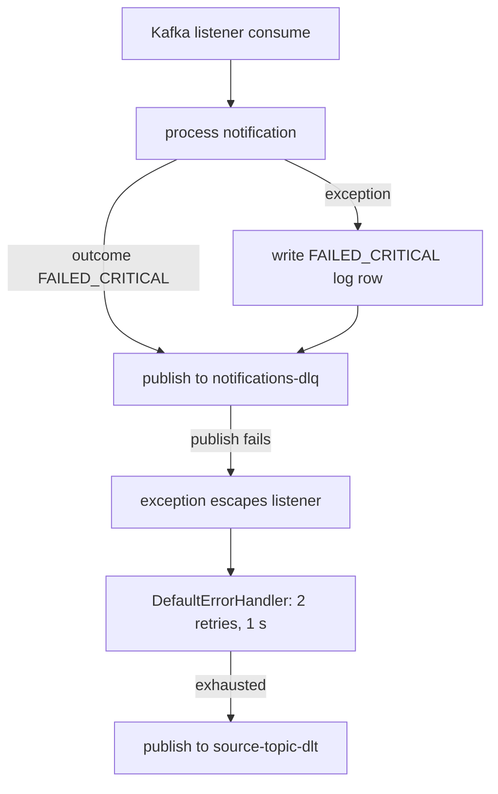

# Runbook: DLQ and dead-letter messages

## Background

There are **two distinct dead-letter paths**. They have different triggers, different payloads, and
different metrics, so identify which one you are looking at first.

| | Application DLQ | Listener dead-letter topics (DLT) |
| --- | --- | --- |
| Topic | `notifications-dlq` (`NOTIFICATION_KAFKA_DLQ_TOPIC`) | `<source topic>-dlt`: `high-priority-topic-dlt`, `medium-priority-topic-dlt`, `low-priority-topic-dlt` (`NOTIFICATION_KAFKA_DLT_SUFFIX`, default `-dlt`) |
| Written by | `KafkaDeadLetterQueueAdapter`, called from `ConsumeNotificationEventService` | Spring Kafka `DeadLetterPublishingRecoverer`, configured in `KafkaConsumerConfig` |
| Trigger | The notification ended `FAILED_CRITICAL` (reason `Critical failure after processing`), or processing threw an unexpected exception (reason `Unexpected error: <message>`) | The listener method threw (or the record could not be deserialized) and the error handler exhausted its retries |
| Retries before dead-lettering | None; it is the last application step | 2 retries at a fixed 1 s backoff (3 deliveries in total), then publish to the DLT on the same partition number as the source record |
| Key / value | Key = notification id. Value = `{"notificationId": "<uuid>"}`. Headers `notificationId` and `reason` | Original record value (a `NotificationEvent` JSON) with the standard Spring Kafka dead-letter headers |
| Counter | `aegisnotify.dlq.publish.error.count{reason}` counts only **failures to publish**. There is no counter of successful DLQ publishes | `notification.kafka.consumer.dlt{topic}` |



Important consequences, all visible in the code:

- A `FAILED_CRITICAL` notification that was routed via the listener goes to **`notifications-dlq`**,
  not to a `-dlt` topic. The Admin UI "DLQ" figure under Metrics > "Kafka consumer health" is the
  `consumer.dlt` counter, so it counts the **DLT path only** and does not reflect `notifications-dlq`
  traffic. Use the count of `FAILED_CRITICAL` notifications to size the application DLQ.
- In the unexpected-exception branch, the service writes a `FAILED_CRITICAL` row to
  `notification_logs` and publishes to the DLQ, but it **does not update the notification's own
  `status`**. That notification keeps whatever status it had (`QUEUED` if template rendering
  failed before processing was committed, or `PROCESSING` if the failure came after). Find these by
  the log detail `Unexpected error:` in the notification's audit trail, not by status filter.
- If publishing to `notifications-dlq` itself fails, the exception reaches the error handler, the
  record is retried (which re-runs processing), and finally lands on the `-dlt` topic. Records are
  not silently lost on this path.
- Nothing in the repository **consumes** `notifications-dlq` or the `-dlt` topics, and there is no
  replay endpoint, scheduler, or UI. `SendToDlqUseCase` exists in the application layer but no
  controller or listener calls it.
- Topic creation is not performed by the application (no `NewTopic` bean). Partition and replication
  settings under `notification.kafka.topics` are validated at startup but topics rely on the
  broker. Confirm the DLQ and DLT topics exist and have a retention policy suited to your recovery
  window; that is broker configuration outside this repository.
- The consumer (`NOTIFICATION_KAFKA_CONSUMER_ENABLED`) and relay (`NOTIFICATION_KAFKA_RELAY_ENABLED`)
  are **off by default**. `docker-compose.full.yml` turns both on for the notification container.

## Symptom

- `FAILED_CRITICAL` notifications accumulate (Dashboard "Failed in latest 20" is non-zero; see
  [runbook 05](05-failed-critical.md)).
- "Kafka consumer health" on `/metrics` shows a non-zero **DLQ** value, a rising **Failure** or
  **Retry** value, and the panel turns warning or danger.
- Messages are present on `notifications-dlq` or a `*-dlt` topic.

## Detection

| Signal | Where |
| --- | --- |
| Consumer success / failure / retry / DLT counts | Admin UI `/metrics` "Kafka consumer health"; `GET /api/v1/metrics/summary` field `kafkaConsumer`; Prometheus `notification_kafka_consumer_success_total`, `_failure_total`, `_retry_total`, `_dlt_total` (tag `topic`) |
| DLQ publish failures | Prometheus `aegisnotify_dlq_publish_error_count_total{reason="timeout"|"execution"|"interrupted"}`; logs `dlq_publish_failed`, `dlq_publish_timed_out`, `dlq_publish_interrupted` (each with `topic` and `notificationId`) |
| Outbox publish failures (upstream) | Prometheus `aegisnotify_outbox_publish_error_count_total{reason}`; see [runbook 04](04-outbox-backlog.md) |
| DLQ message content | Kafka CLI (below) |
| Consumer lag on the service group | `kafka-consumer-groups --describe --group notification-service` (group id is `NOTIFICATION_KAFKA_CONSUMER_GROUP_ID`) |
| Listener activity | Log `notification_event_received topic=... key=... notificationId=...` (INFO) |

There is no alert rule shipped. Practical alerts: `increase(notification_kafka_consumer_dlt_total[5m]) > 0`
and any increase of `aegisnotify_dlq_publish_error_count_total`, after confirming the series names
on a live scrape.

## Diagnosis

The commands below are **standard Kafka CLI** run inside the compose broker container
`aegis-kafka` (it listens on `localhost:9092` inside the container). Adjust for your environment.
They are not provided by this repository and were not executed while writing this runbook.

1. **List topics** and confirm the DLQ and DLT topics exist:

   ```bash
   docker exec aegis-kafka kafka-topics --bootstrap-server localhost:9092 --list
   ```

2. **Read DLQ messages with keys and headers** (the `reason` header explains why):

   ```bash
   docker exec aegis-kafka kafka-console-consumer --bootstrap-server localhost:9092 \
     --topic notifications-dlq --from-beginning --timeout-ms 10000 \
     --property print.key=true --property print.headers=true
   ```

   Without `--group` this uses a throwaway group and does not move any real consumer's offsets.
   Do the same for each `*-dlt` topic. Use `--partition` and `--offset` to read a specific record.

3. **Group the failures.** Use the `reason` header and the notification's audit trail
   (`GET /api/v1/notifications/{id}/status`, or the detail page) to bucket by cause:
   - `Critical failure after processing`: both providers failed. The notification's "Provider
     attempts" table shows why. Treat as a provider problem
     ([runbook 02](02-provider-failover.md)).
   - `Unexpected error: ...`: an exception in processing, commonly template not found or inactive
     (`TemplateNotFoundException`), template rendering failure (missing variable), or a database
     error. These do not depend on providers.
   - A record on a `-dlt` topic: the listener threw repeatedly or the payload could not be
     deserialized. Read the dead-letter headers for the exception message.
4. **Check the consumer is healthy**: `kafka-consumer-groups --describe --group notification-service`
   should show the three priority topics assigned and lag near zero.

## Remediation

There is **no supported replay tool**. The steps below are derived from the code and are a manual
procedure; run them for a small batch first.

### 1. Fix the cause before replaying

Replaying into an unfixed fault produces another dead letter. Examples: restore or reactivate the
template named in the notification, restore provider credentials, or wait for the circuit to close.

### 2. Decide whether to replay at all

- The consumer reloads the notification from PostgreSQL by id and renders it from the stored
  parameters; the Kafka message body is not used beyond the id (`consume(record.value().id())`).
  A replay therefore re-attempts delivery of the stored notification.
- Delivery is **at-least-once**. If a provider accepted the message but the call timed out or the
  outcome was lost, a replay can deliver a duplicate. Inspect "Provider attempts" first.
- `retry` through the REST API is **not** an option for these notifications:
  `POST /api/v1/notifications/{id}/retry` only accepts status `FAILED` and returns 409 for
  `FAILED_CRITICAL`, `QUEUED`, or `PROCESSING`.

### 3. Replay one notification (manual)

Fetch the original outbox payload, which is exactly what was first published to the priority topic:

```sql
SELECT payload FROM outbox_events WHERE notification_id = '<notification-uuid>';
```

Publish that JSON back to the topic matching its `priority` (`high-priority-topic`,
`medium-priority-topic`, or `low-priority-topic`; defaults shown, overridable by environment
variables). The listener consumes all three:

```bash
echo '<payload-json-on-one-line>' | docker exec -i aegis-kafka kafka-console-producer \
  --bootstrap-server localhost:9092 --topic medium-priority-topic
```

The service then runs `prepare` (status becomes `PROCESSING`, no status guard prevents this from
`FAILED_CRITICAL`), calls the provider, and records the new outcome in `notification_logs`,
`delivery_attempts` and the audit stream. Confirm with `GET /api/v1/notifications/{id}/status`.

The same procedure works for records on a `-dlt` topic: the value is the original
`NotificationEvent` JSON, which can be republished to its source topic once the cause is fixed.

### 4. Dealing with the DLQ topic itself

- Records are not deleted when replayed. Track which ids you have replayed (a ticket or
  spreadsheet) because nothing in the platform marks DLQ entries as handled.
- If a record is permanently undeliverable (invalid recipient, deleted template, abandoned
  campaign), leave the notification as `FAILED_CRITICAL` and document the decision; there is no
  "discard" or "resolve" state in the data model.
- Do not purge the topic until the recorded retention window has elapsed, so incident reviews can
  still read it.

### 5. If the DLQ publish itself is failing

`dlq_publish_*` logs or `aegisnotify_dlq_publish_error_count_total` mean the broker is unreachable or
slow (the adapter waits up to 10 s for the broker acknowledgement). Fix Kafka first
([runbook 06](06-dependency-outages.md), Kafka section). The producer is configured with `acks=all`,
idempotence on, and unbounded retries, so a brief broker outage does not lose messages already handed
to the producer.

## Escalation

Escalate when:

- DLQ or DLT volume keeps growing after the cause is believed fixed.
- `aegisnotify_dlq_publish_error_count_total` increases (dead letters may not be recorded).
- Dead letters of the `Unexpected error:` class appear without an identifiable template, data, or
  deployment change (suggests a code defect).
- Replay produces duplicates or new dead letters for the same ids.

Attach: the DLQ record (key, value, `reason` header), the notification `/status` output,
consumer-group lag, and the relevant log lines. No on-call route is defined in the repository.
