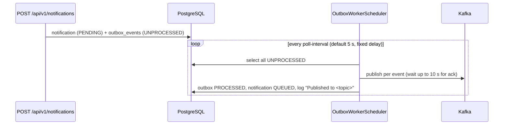

# Runbook: outbox backlog and stuck events

## Background

Submitting a notification (`CreateNotificationService`) writes the `notifications` row, a
`notification_logs` row and an `outbox_events` row (`status = UNPROCESSED`) in **one database
transaction**. A background relay then publishes each event to Kafka.



Behavior that matters operationally (`OutboxWorkerScheduler`, `PublishOutboxEventService`,
`PublishOutboxEventTransactions`, `KafkaMessageBrokerAdapter`):

- **The relay is off by default.** It only exists when `notification.kafka.relay.enabled=true`
  (`NOTIFICATION_KAFKA_RELAY_ENABLED`, default `false`). With it off, every notification stays
  `PENDING` forever. `docker-compose.full.yml` enables it; a bare local run does not.
- Poll interval: `notification.kafka.relay.poll-interval` (`NOTIFICATION_KAFKA_RELAY_POLL_INTERVAL`,
  default `PT5S`), as a **fixed delay** after the previous tick finishes.
- Each tick reads **all** `UNPROCESSED` events with no batch limit and no explicit ordering, then
  publishes them one at a time, each in its own transaction. A failure rolls back only that event,
  leaves it `UNPROCESSED`, logs a warning, and the loop continues with the next event.
- The publish is synchronous and waits up to 10 s for the broker acknowledgement. A broker outage
  therefore slows each tick roughly in proportion to the number of pending events.
- Topics are chosen from the payload `priority`: `high-priority-topic`, `medium-priority-topic`,
  `low-priority-topic` (resolved to the configured `NOTIFICATION_KAFKA_*_TOPIC` names).
- Delivery is **at-least-once**: if Kafka acknowledges but the database commit then fails, the event
  is published again on the next tick.
- **There is no retry limit or terminal failure state in code.** The table has a `retry_count`
  column and the statuses `PROCESSING` and `FAILED`, but nothing writes them; the relay only reads
  `UNPROCESSED` and only ever writes `PROCESSED`. A failing event is retried every tick indefinitely.
- Aggregation (`NOTIFICATION_AGGREGATION_ENABLED`, default `false`): when on, eligible events
  (non-`HIGH` priority, not excluded by template or channel) are **held** instead of published. The
  outbox row is marked `PROCESSED`, a row is inserted in `aggregation_buffer`, and the notification
  **stays `PENDING`** with log "Held for aggregation" until the window (default `PT5M`) is flushed.
  A `PENDING` notification whose outbox row is `PROCESSED` is therefore not a stuck outbox event.

## Symptom

- Notifications remain `PENDING` well beyond the poll interval.
- `outbox_events` has a growing number of rows with `status = 'UNPROCESSED'`.
- Nothing arrives on the priority topics; the Kafka consumer counters stop increasing.
- Admin UI `/notifications` filtered by Status `PENDING` shows an ageing list.

## Detection

No metric or endpoint reports outbox depth. Use these signals:

| Signal | Where |
| --- | --- |
| Backlog size and age | SQL (below) |
| Aged `PENDING` notifications | Admin UI `/notifications`, filter Status = `PENDING`; or `GET /api/v1/notifications?status=PENDING&limit=100` (`limit` accepts 1 to 100; compare each `createdAt` with now) |
| Publish failures | Prometheus `aegisnotify_outbox_publish_error_count_total{reason="timeout"|"execution"|"interrupted"}` |
| Relay log lines | `outbox_relay_tick_completed publishedCount=N` (INFO, only when N > 0); `outbox_relay_tick_failed reason=...` (WARN); `outbox_event_publish_failed outboxEventId=... notificationId=... reason=...` (WARN); `kafka_publish_failed`, `kafka_publish_timed_out` (WARN) |
| Downstream starvation | `notification_kafka_consumer_success_total` flat while submissions continue; `aegisnotify_requests_total` rising |
| Service health | `GET /actuator/health` (does not include outbox depth) |

SQL (PostgreSQL, database `aegisnotify` by default; for the compose stack use
`docker exec -it aegis-postgres psql -U aegis -d aegisnotify`):

```sql
-- Backlog by status and oldest age
SELECT status, count(*) AS events, min(created_at) AS oldest
FROM outbox_events GROUP BY status;

-- Age of the oldest unprocessed event
SELECT now() - min(created_at) AS oldest_age
FROM outbox_events WHERE status = 'UNPROCESSED';

-- Notifications by status
SELECT status, count(*) FROM notifications GROUP BY status;
```

There is no alert rule shipped. A sensible alert is "oldest `UNPROCESSED` event older than a few
poll intervals", which has to be implemented as a SQL-based check because no Prometheus series exists.

## Diagnosis

Work from the cheapest check to the most specific.

1. **Is the relay running?** Check the effective value of `NOTIFICATION_KAFKA_RELAY_ENABLED` for the
   notification service. If it is not `true`, this is the cause. Also confirm the service itself
   is up (`/actuator/health`).
2. **Is the aggregation hold the explanation?** If `NOTIFICATION_AGGREGATION_ENABLED=true`, check:

   ```sql
   SELECT status, count(*), min(expires_at) FROM aggregation_buffer GROUP BY status;
   ```

   `BUFFERED` rows with a future `expires_at` are waiting for the window. Expired `BUFFERED` rows or
   `CLAIMED` rows past the lease (default `PT2M`) mean the flush scheduler is failing; look for
   `aggregation_flush_tick_failed`, `aggregation_buffer_flush_failed`, and
   `aegisnotify_aggregation_flush_error_count_total{reason}`. Rows that exceed
   `NOTIFICATION_AGGREGATION_MAX_ATTEMPTS` (default 3) are forced to `DONE`.
3. **Is Kafka reachable?** If `kafka_publish_failed` or `kafka_publish_timed_out` appear, or
   `aegisnotify_outbox_publish_error_count_total` increases, the problem is the broker or the
   network path to `KAFKA_BOOTSTRAP_SERVERS`. See [runbook 06](06-dependency-outages.md).
4. **One event or all events?** Read `outbox_event_publish_failed` lines.
   - Different `outboxEventId` values, all with Kafka-related reasons: broker problem.
   - The same `outboxEventId` every tick with a non-Kafka reason (for example
     `No enum constant ...Priority.<value>` or a null pointer): a malformed payload. It will never
     succeed and will be retried and logged every poll forever. It does not block other events,
     which are still attempted in the same tick, but it adds noise and a little load.
5. **Is the tick starving?** With a very large backlog and Kafka degraded, each tick may take a long
   time (up to ~10 s per failing event). Compare the `publishedCount` values in
   `outbox_relay_tick_completed` over time. The scheduler pool has two threads
   (`spring.task.scheduling.pool.size: 2`), so the aggregation poller is not blocked by a slow relay.
6. **Is the database the bottleneck?** Slow queries, connection exhaustion, or a failing commit show
   up as `outbox_relay_tick_failed` (the whole poll failed) rather than per-event warnings.
7. **Consumer side.** If the outbox drains (`QUEUED` notifications rise) but nothing is delivered,
   the issue is downstream: the consumer is disabled (`NOTIFICATION_KAFKA_CONSUMER_ENABLED`,
   default `false`), not assigned partitions, or failing; see [runbook 03](03-dlq-messages.md).

## Remediation

1. **Relay disabled**: set `NOTIFICATION_KAFKA_RELAY_ENABLED=true` and restart the notification
   service. There is no runtime toggle. Pending events publish on the first tick; there is no rate
   limit, so a large backlog is published in one burst, which then lands on the consumer.
2. **Kafka unavailable**: restore the broker. No operator action on the outbox is needed; events
   remain `UNPROCESSED` and drain automatically. The producer is configured with `acks=all`,
   idempotence and unbounded client retries, so nothing is lost. Watch the first ticks after
   recovery for `outbox_relay_tick_completed`.
3. **Consumer disabled or failing**: enable `NOTIFICATION_KAFKA_CONSUMER_ENABLED=true` and restart,
   or follow runbook 03. Messages wait on the topics (`auto.offset.reset=earliest` for a new group).
4. **Aggregation hold**: no action while rows are within their window. For failing flushes, fix the
   cause (summarizer API key, template removed) or disable aggregation
   (`NOTIFICATION_AGGREGATION_ENABLED=false`) and restart. When the summarizer is unavailable, the
   flush falls back to individual delivery, so notifications are not dropped.
5. **Poison event (malformed payload)**: there is no supported mechanism to skip or quarantine an
   outbox row. Do not delete it; keep it as evidence for the defect report. If the noise
   cannot be tolerated, an operator can, as a last resort and with the owning team's approval,
   set that single row's status to `FAILED`, which the relay ignores and the table's check
   constraint allows. This is a manual database change that bypasses the application, is not
   covered by any test, and must be recorded in the incident notes:

   ```sql
   UPDATE outbox_events SET status = 'FAILED' WHERE id = '<outbox-event-uuid>';
   ```

   Then decide the notification's fate (resubmit a corrected notification, or leave it `PENDING`
   with a note). Open a defect for the payload that produced the poison row.
6. **Do not use `PATCH /api/v1/notifications/{id}/cancel` to dismiss a stuck event.** Cancel only
   updates the notification; it does not touch the outbox row. In the code the relay's publish path
   does not check for `CANCELLED` and sets the status to `QUEUED`, so the event can still be
   published and delivered. This behavior was read from the code and has not been tested.
7. **Verify**: `SELECT count(*) FROM outbox_events WHERE status='UNPROCESSED'` trends to zero, aged
   `PENDING` notifications become `QUEUED`, then `SENT` or `SENT_VIA_FALLBACK`.

## Escalation

Escalate when:

- The oldest `UNPROCESSED` event keeps ageing after Kafka is confirmed healthy and the relay is
  enabled (indicates a defect or database problem).
- `outbox_relay_tick_failed` repeats (the poll itself fails).
- A poison event is found; payload corruption means a defect in a producer path.
- The backlog is large enough that a post-recovery burst could overwhelm providers or the consumer
  (coordinate with the provider owners before re-enabling the relay).

Attach: the SQL outputs above, the log lines with `outboxEventId` and `reason`, relay and consumer
flags, and Kafka broker status. No on-call route is defined in the repository.
