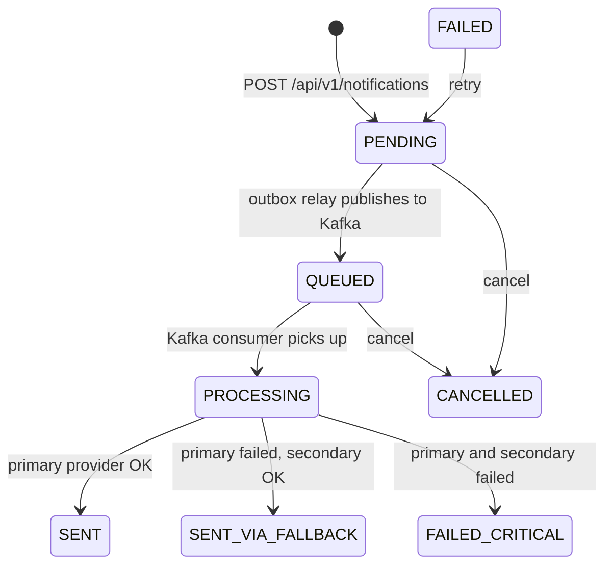

# AegisNotify operational runbooks

Procedures for the failure modes the notification platform is designed around. Each runbook
follows the same structure: **symptom, detection, diagnosis, remediation, escalation**.

| Runbook | Use it when |
| --- | --- |
| [Open circuit breaker](01-circuit-breaker-open.md) | A provider circuit is `OPEN` / `FORCED_OPEN`, or `CIRCUIT_OPEN` shows in delivery attempts |
| [Provider failover and outage](02-provider-failover.md) | Fallback activations rise, or a primary provider is degraded or down |
| [DLQ and dead-letter messages](03-dlq-messages.md) | Messages arrive on `notifications-dlq` or a `*-dlt` topic, or the Kafka "DLQ" counter rises |
| [Outbox backlog / stuck events](04-outbox-backlog.md) | Notifications stay `PENDING`, or `outbox_events` rows pile up in `UNPROCESSED` |
| [FAILED_CRITICAL notifications](05-failed-critical.md) | Notifications end in `FAILED_CRITICAL` |
| [Dependency outages](06-dependency-outages.md) | Keycloak, Eureka, or Config Server is unavailable (Kafka, PostgreSQL, Redis covered briefly) |

For the full metric catalog, a sample Prometheus scrape config, suggested dashboard panels, and suggested
alert rules that point back to these runbooks, see [Observability](../observability.md).

## How to read these runbooks

These documents are written against the code and configuration in this repository, not against a
specific production deployment. Three rules apply throughout:

1. **Only documented signals are used.** Metric names, endpoints, log keys, and UI screens are
   taken from the source. Where the repository has no mechanism (for example a replay API or an
   alert rule), the runbook says so explicitly rather than implying one exists.
2. **Prometheus names.** Meter names are declared in code with dots (for example
   `aegisnotify.fallback.transmissions`). The Prometheus registry exposes them with underscores
   and a `_total` suffix on counters. The tests assert this form for `notification_kafka_consumer_*_total`,
   `resilience4j_circuitbreaker_state` and `resilience4j_circuitbreaker_calls_seconds_count`; the
   other names below follow the same Micrometer convention but are not asserted by a test, so
   confirm them against a live `/actuator/prometheus` scrape before building alerts.
3. **Commands marked "standard Kafka CLI" or "SQL" are generic tooling.** The repository does not
   ship scripts for them. They were derived from the schema and topic configuration, and have not
   been executed as part of writing these documents.

## What the platform does not provide

Knowing the gaps up front avoids searching for tooling that is not there:

- No Prometheus alert rules, Grafana dashboards, or scrape configuration are committed. Suggested
  ones, untested against a live Prometheus, are in [Observability](../observability.md).
- No on-call, paging, or ticketing integration exists. Escalation sections therefore describe
  *when* to escalate and *what evidence to attach*; the owning team must supply the contact path.
- No DLQ browser or replay tool exists, and nothing in the codebase consumes `notifications-dlq`.
- The admin UI has no retry, cancel, or replay control. Retry and cancel exist only as REST
  endpoints on the notification service.
- No metric or endpoint reports outbox depth. Backlog is detected with SQL or by filtering
  notifications on status `PENDING`.

## Reference: services and ports

| Service | Port | Health | Notes |
| --- | ---: | --- | --- |
| `aegis-api-gateway` | 8080 | `/actuator/health` | Public entry point; does **not** route `retry` or `cancel` |
| `aegis-notification-service` | 8082 | `/actuator/health` | Exposes `health`, `info`, `prometheus`, `circuitbreakers` |
| `aegis-audit-service` | 8083 | `/actuator/health` | |
| `aegis-user-service` | 8084 | `/actuator/health` | |
| `aegis-eureka-server` | 8761 | `/actuator/health` | HTTP Basic (`EUREKA_SECURITY_USER`) |
| `aegis-config-server` | 8888 | `/actuator/health` | HTTP Basic (`CONFIG_SERVER_USER`) |
| Keycloak | 8088 (host) | not probed in compose | Realm `aegis` |

Ports come from each service's `application.yml` and `docker-compose*.yml`.

## Reference: notification endpoints used in these runbooks

All are served by `aegis-notification-service` (port 8082). They require a bearer JWT; the scope
mapping is in `SecurityConfig`.

| Method and path | Scope | Purpose |
| --- | --- | --- |
| `GET /api/v1/notifications?status=&channel=` | `notification:read` | List notifications |
| `GET /api/v1/notifications/{id}/status` | `notification:read` | Status, audit trail, delivery attempts |
| `POST /api/v1/notifications/{id}/retry` | `notification:write` | Re-queue a notification in status `FAILED` only (409 otherwise) |
| `PATCH /api/v1/notifications/{id}/cancel` | `notification:write` | Cancel a `PENDING` or `QUEUED` notification |
| `GET /api/v1/dashboard/circuit-breakers` | `notification:read` | Circuit state and 24h call metrics per provider |
| `GET /api/v1/dashboard/summary` | `notification:read` | 24h totals, success rate, fallback activations |
| `GET /api/v1/metrics/summary` | `notification:read` | In-process counters (channel, errors, fallback, Kafka consumer) |
| `GET /actuator/prometheus` | public | Prometheus scrape |
| `GET /actuator/health` | public | Liveness/readiness summary |
| `GET /actuator/circuitbreakers` | authenticated | Resilience4j circuit breaker detail |

The gateway routes only `POST /api/v1/notifications`, `GET /api/v1/notifications[/*/status]`,
`/api/v1/dashboard/**`, `/api/v1/metrics/**` (GET), `/api/v1/templates/**`, users, and audit.
`retry` and `cancel` must be called against the notification service directly.

## Reference: admin UI screens

The admin frontend (`aegis-admin-frontend`, default `http://localhost:4200`) provides:

| Route | Screen | Used for |
| --- | --- | --- |
| `/dashboard` | Dashboard | "Provider circuit breakers" panel, "Fallback activations", "Failed in latest 20" |
| `/notifications` | Notifications list | Filter by Status, channel, recipient |
| `/notifications/:id` | Notification detail | Delivery timeline and "Provider attempts" table |
| `/providers` | Providers | Per-provider circuit state, failure rate, slow-call rate, calls (24h) |
| `/metrics` | Metrics | Delivery latency, fallback transmissions, "Kafka consumer health", "Provider errors" |

Metrics shown on `/metrics` are **in-process Micrometer meters**. They reset when the notification
service restarts and are per instance.

## Notification lifecycle (for orientation)

`FAILED` exists in the enum and is the only state `retry` accepts, but no code path in the
resilient provider adapter currently produces it; provider exhaustion yields `FAILED_CRITICAL`.
See [FAILED_CRITICAL notifications](05-failed-critical.md).
