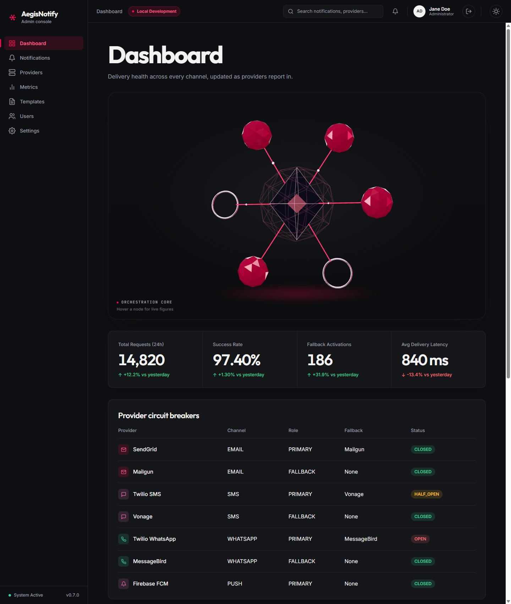
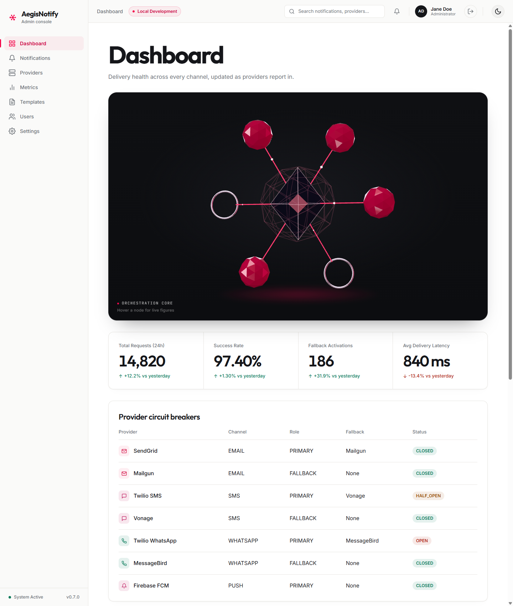

# AegisNotify Admin Console: User Manual

This manual explains how to use the AegisNotify admin console, the web application that
operators and support staff use to watch notification delivery, check provider health, manage
message templates, and administer user accounts.

It is written for people who use the console. It does not require programming knowledge.

> **Screenshots use sample data.** The screenshots in this manual were captured from the console
> running against a mocked identity provider and a mocked API. The notification IDs, recipients,
> counts, percentages, provider names, user names, and role names shown in the images are
> illustrative. They are not output from a real system, and your environment will show different
> values. Where the real behavior differs from a screenshot, the text of the manual describes the
> real behavior.

## How to read this manual

- Start with the page for the screen you are using. Each page follows the same order: purpose,
  how to open the screen, what each area means, the actions you can take, and what to expect.
- Numbered callouts such as **(1)** in the text refer to areas of the screenshot directly above
  them, counted from top to bottom and left to right. The images themselves are not annotated.
- Terms in `MONOSPACE` (for example `FAILED_CRITICAL` or `HALF_OPEN`) are the exact labels shown in
  the console. The [glossary](glossary.md) explains each one.
- Anything that depends on how your administrators configured the platform is marked as such. The
  manual only describes behavior that was checked against the product source code.

## Pages

| Page | What it covers |
| --- | --- |
| [Dashboard](dashboard.md) | Overall delivery health: key indicators, provider circuit breakers, recent notifications |
| [Notifications](notifications.md) | Searching and filtering notifications, and reading the detail view with its timeline and provider attempts |
| [Providers](providers.md) | Health of each delivery provider, grouped by channel |
| [Metrics](metrics.md) | Requests per channel, delivery latency, message consumer health, provider errors |
| [Templates](templates.md) | Listing, creating, editing, activating, and deactivating message templates |
| [Users and roles](users-and-roles.md) | Creating and editing users, assigning roles, resetting passwords, enabling and disabling accounts |
| [Settings](settings.md) | Read-only runtime information |
| [Roles and permissions](roles-and-permissions.md) | What each kind of access allows, derived from the platform source |
| [Glossary](glossary.md) | Notification states, channels, priorities, circuit-breaker states, and other terms |
| [Troubleshooting and FAQ](troubleshooting.md) | Common problems and what they mean |

## Signing in and out

The console does not have its own login form. When you open it without an active session, it
redirects you to the AegisNotify sign-in page (served by Keycloak). After you sign in you return to
the page you originally requested. Use **Log out** in the top bar to end the session.

## The console layout

The layout is the same on every screen.

*The dashboard in the dark theme. (1) Sidebar. (2) Top bar. (3) Page content.*

*The same screen in the light theme. Screenshots use sample data.*

**(1) Sidebar.** Links to the seven screens: Dashboard, Notifications, Providers, Metrics,
Templates, Users, and Settings. The current screen is highlighted. The footer shows a static
"System Active" label and a version label. Both are fixed text in the page, not live checks, so
do not use them to judge system health. Use the [Dashboard](dashboard.md) and
[Providers](providers.md) screens for that.

**(2) Top bar**, from left to right:

| Element | Meaning |
| --- | --- |
| Screen title | Name of the current screen. On the Templates and Users screens the title currently shows "Dashboard" (see [Troubleshooting](troubleshooting.md#the-top-bar-title-says-dashboard-on-the-templates-or-users-screen)). |
| Environment badge | Fixed label reading "Local Development" in the current build. It is not read from the server. For the environment the console was built for, see [Settings](settings.md). |
| Search box | Present in the top bar, but it is not connected to any search function in the current build. To search, use the filters on the [Notifications](notifications.md) and [Users](users-and-roles.md) screens. |
| Notifications bell | Opens a small panel. The panel currently always reads "No new notifications". |
| User name and role label | Your display name comes from your sign-in. The role label is fixed text ("Administrator") and does not reflect your actual access. See [Roles and permissions](roles-and-permissions.md). |
| **Log out** | Ends your session and returns you to the console start page. |
| **Toggle theme** | Switches between the light and dark themes. |

## Related documents

- [Root README](../../README.md): project overview and how the platform is started.
- [OAuth2 scopes](../security/scopes.md): the access scopes enforced by the platform.
- [Architecture](../ARCHITECTURE.md): technical design, for developers.
