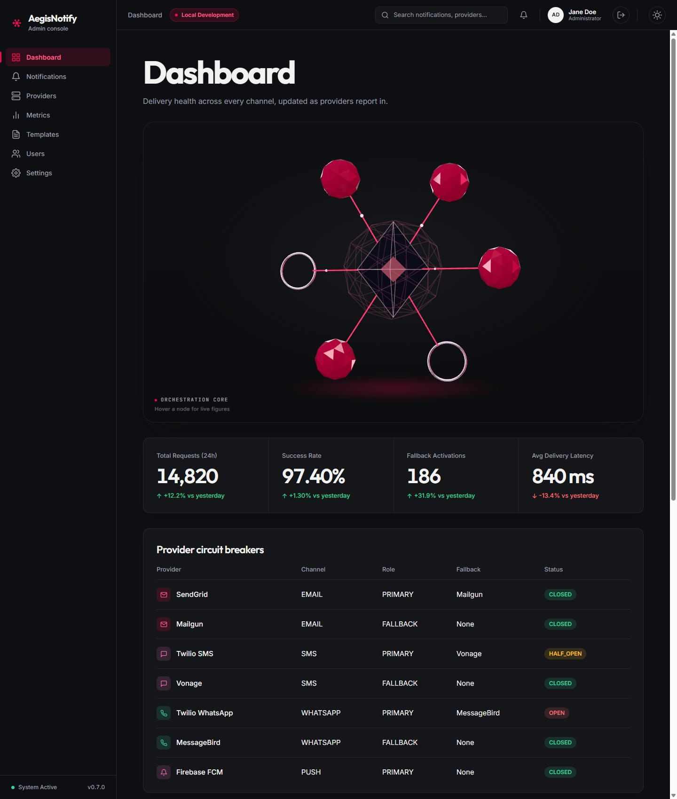

# Dashboard

[Manual index](README.md) | Next: [Notifications](notifications.md)

## Purpose

The Dashboard is the landing page. It answers three questions at a glance: how much traffic the
platform handled in the last 24 hours, whether delivery is healthy, and whether any delivery
provider is currently failing.

Open it from **Dashboard** in the sidebar. It is also the page the console opens by default, and
unknown addresses redirect to it.

*Dashboard, dark theme. (1) Orchestration core. (2) Key indicators. (3) Provider circuit breakers.
(4) Recent notifications (below the visible area). Screenshots use sample data.*

## Areas of the screen

### (1) Orchestration core

A three-dimensional graphic. Hovering over one of its nodes shows a live figure taken from the same
data as the rest of the page. The six figures are:

| Node label | Value shown |
| --- | --- |
| Delivery latency | Average delivery latency over the last 24 hours, in ms |
| Success rate | Success rate over the last 24 hours |
| Requests, last 24h | Total requests over the last 24 hours |
| Failed in latest 20 | How many of the 20 most recent notifications are `FAILED` or `FAILED_CRITICAL` |
| Fallback activations | Number of fallback activations |
| Circuit breakers | Number of closed circuit breakers out of the total, for example `6/8 closed` |

The graphic is decorative. Everything it shows is also available in the tiles and tables below it.
Until data arrives, the figures show a dash.

### (2) Key indicators

Four tiles. Each shows a value and a comparison with the previous day.

| Tile | Meaning |
| --- | --- |
| **Total Requests (24h)** | Notification requests received in the last 24 hours. |
| **Success Rate** | Share of deliveries that succeeded in the last 24 hours. |
| **Fallback Activations** | How often delivery moved from the primary provider to the secondary provider. |
| **Avg Delivery Latency** | Average time to deliver, in milliseconds. |

The line under each value reads, for example, "+12.2% vs yesterday". An up or down arrow indicates
the direction of the change. If there is no data for the previous day, the line reads "No prior
baseline". For the Success Rate tile the change is calculated as a difference in percentage points.

The tiles are loaded once when you open the page. To refresh them, reload the page or leave and
return to the Dashboard.

### (3) Provider circuit breakers

One row per delivery provider.

| Column | Meaning |
| --- | --- |
| **Provider** | Name of the provider, with an icon for its channel. |
| **Channel** | `EMAIL`, `SMS`, `WHATSAPP`, or `PUSH`. |
| **Role** | `PRIMARY` (used first) or `FALLBACK` (used when the primary is unavailable or fails). |
| **Fallback** | For a primary provider, the name of its fallback provider. For a fallback provider, `None`. |
| **Status** | The circuit-breaker state, colored: green for `CLOSED`, amber for `HALF_OPEN`, red for `OPEN` or `FORCED_OPEN`, grey for anything else. |

This table refreshes by itself every 10 seconds. See the [glossary](glossary.md#circuit-breaker-states)
for what each state means. A fallback provider has no circuit breaker of its own, so its status
reads `NOT_PROTECTED`.

If the table cannot be loaded, it shows "Couldn't load circuit breaker status." with a **Retry**
button. If no providers report, it shows "No circuit breakers reporting."

The provider names in the screenshot (for example Mailgun, Vonage, MessageBird) are sample data.
The names shown in your environment come from the platform configuration.

### (4) Recent notifications

The 20 most recent notifications, with the columns **ID**, **Channel**, **Priority**, **Status**,
and **Timestamp** (time of day). Select a row to open its [detail view](notifications.md#notification-detail).
**View all** opens the full [Notifications](notifications.md) list.

If there are none, the panel reads "No notifications in the last 24h". If loading fails, it shows
"Couldn't load recent notifications." with **Retry**.

## Actions

| Action | Result |
| --- | --- |
| Hover over a node of the Orchestration core | A live figure appears. |
| Select a row in Recent notifications | Opens that notification's detail view. |
| Select **View all** | Opens the Notifications list. |
| Select **Retry** in an error message | Reloads only that section. |

## What to expect

- A healthy system shows mostly `CLOSED` statuses and a high Success Rate.
- An `OPEN` status means delivery for that channel is currently going through the fallback
  provider. See [Troubleshooting](troubleshooting.md#a-circuit-breaker-is-open).
- If every section is empty or in error, see [Troubleshooting](troubleshooting.md#the-dashboard-is-empty-or-shows-errors).
