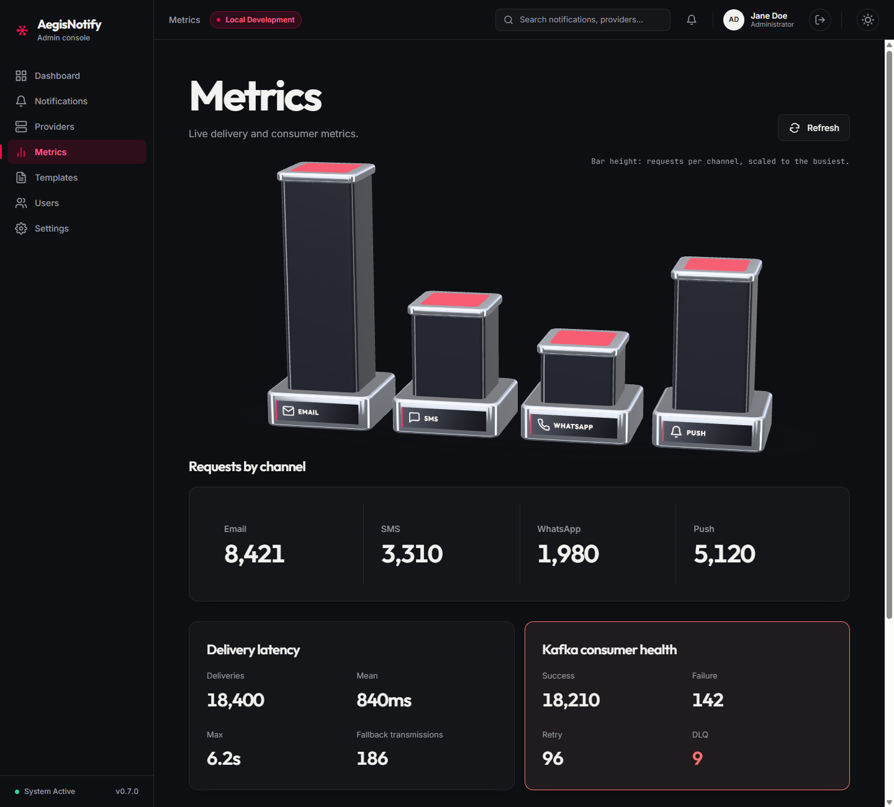

# Metrics

[Manual index](README.md) | Previous: [Providers](providers.md) | Next: [Templates](templates.md)

## Purpose

The Metrics screen gives a numeric summary of platform activity: how many requests each channel
received, how long deliveries take, how the message consumer is coping, and which provider errors
occurred. Use it to spot trends or problems that do not show up in a single notification.

Open it from **Metrics** in the sidebar. The screen is read-only. It loads when you open it and
does not refresh by itself. Select **Refresh** to load current figures.

*Metrics screen. (1) Refresh button. (2) Bar chart. (3) Requests by channel. (4) Delivery latency.
(5) Kafka consumer health. The Provider errors section is below the visible area. Screenshots use
sample data.*

## Areas of the screen

### (1) Refresh

Reloads all figures. While loading, placeholder blocks are shown. If loading fails, the screen
shows "Couldn't load metrics." with a **Retry** button and the chart returns to its resting state.

### (2) Bar chart

A three-dimensional bar chart with one bar per channel. The caption reads "Bar height: requests per
channel, scaled to the busiest." Bars are relative: the busiest channel is the tallest. Read exact
numbers from the cards below the chart.

### (3) Requests by channel

Four figures: **Email**, **SMS**, **WhatsApp**, and **Push**. Each is the number of requests for
that channel.

### (4) Delivery latency

| Field | Meaning |
| --- | --- |
| **Deliveries** | Number of deliveries measured. |
| **Mean** | Average delivery time. Shown in milliseconds below one second, otherwise in seconds. |
| **Max** | Longest delivery time. |
| **Fallback transmissions** | Number of messages delivered by the fallback provider. |

### (5) Kafka consumer health

Kafka is the message broker that carries notifications between the services. The consumer is the
part that picks messages up and delivers them.

| Field | Meaning |
| --- | --- |
| **Success** | Messages processed successfully. |
| **Failure** | Messages whose processing failed. |
| **Retry** | Messages that were retried. |
| **DLQ** | Messages sent to the dead-letter queue, which holds messages that could not be delivered. See the [glossary](glossary.md#delivery-and-failure-terms). |

The card changes color to flag trouble: red when **DLQ** is above zero, amber when **Failure** is
10% or more of **Success** plus **Failure**.

### (6) Provider errors

A table with the columns **Provider**, **Error code**, and **Count**, listing errors returned by
providers. If there are none it reads "No provider errors". This section is below the area shown in
the screenshot.

## Actions

| Action | Result |
| --- | --- |
| **Refresh** | Loads current figures. |
| **Retry** (on error) | Tries to load again. |

## What to expect

- The figures are a snapshot taken when the screen was loaded or last refreshed.
- These figures come from live counters kept inside the notification service, not from the
  notification database. The [Dashboard](dashboard.md) is calculated differently, so related
  figures (for example fallback activations and fallback transmissions) may not match exactly.
- If the numbers look unrealistic, see
  [Troubleshooting](troubleshooting.md#the-metrics-screen-shows-zeros-or-unusual-numbers).
