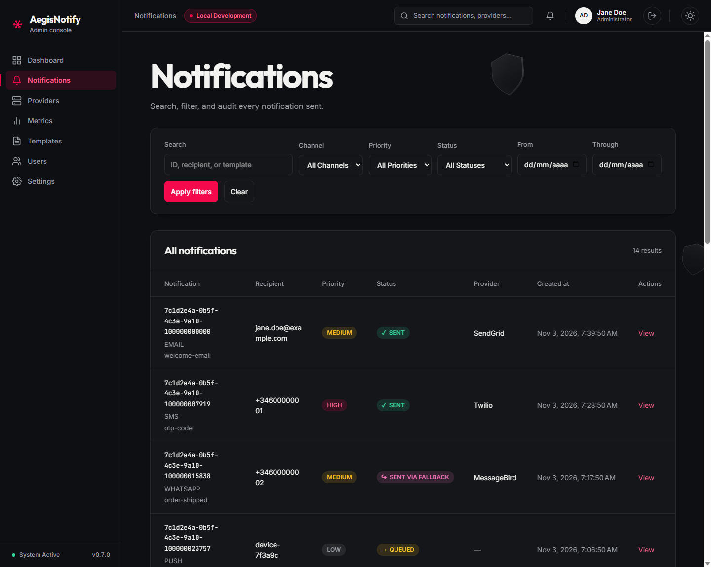
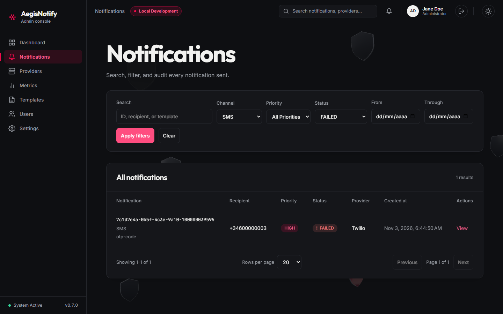
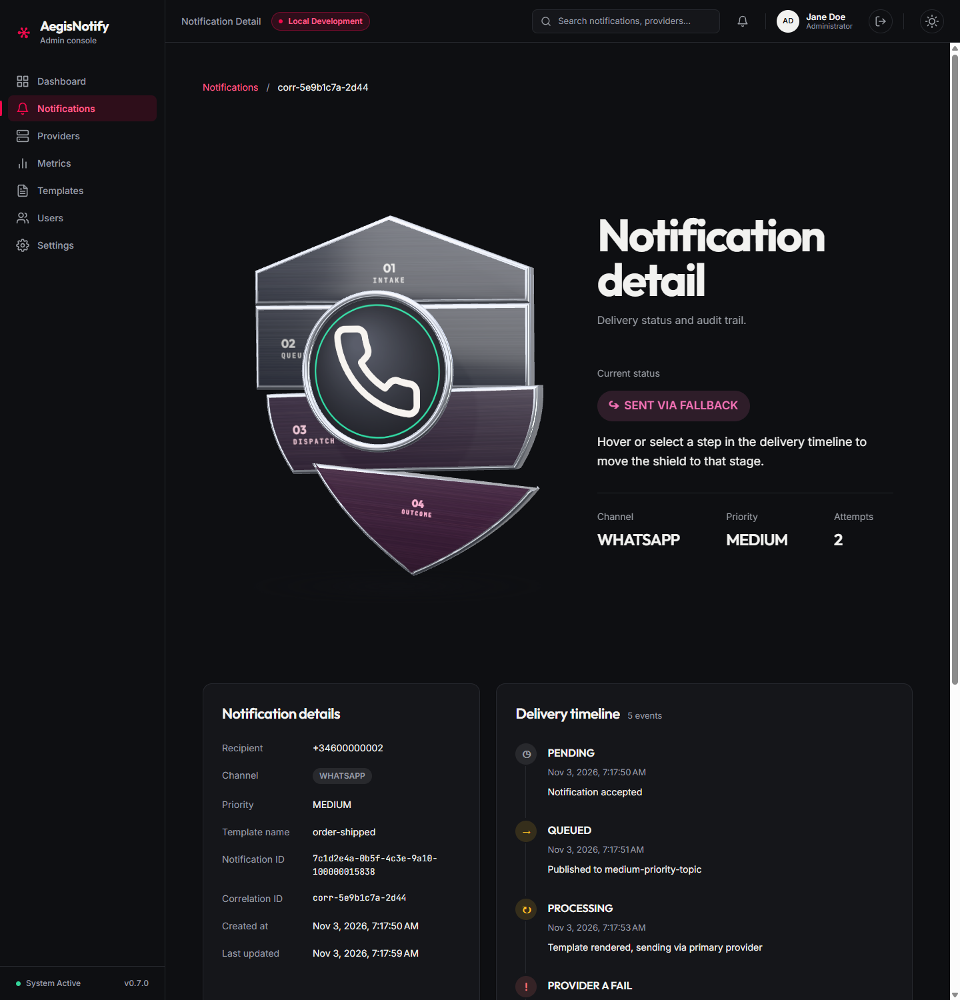
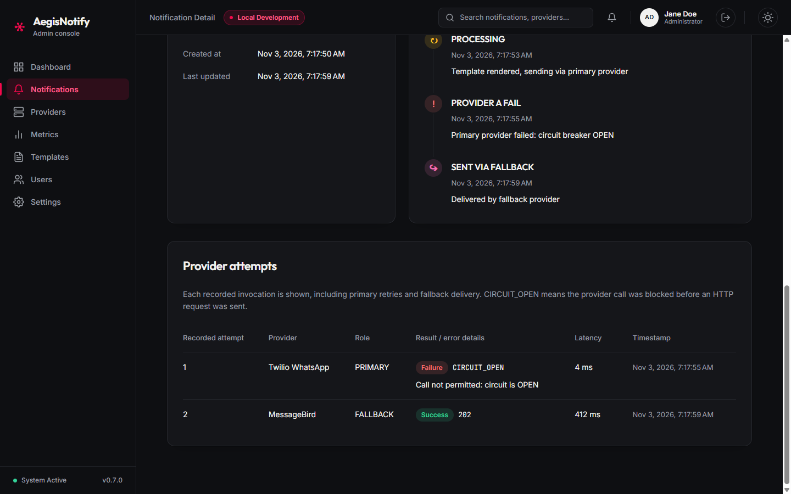

# Notifications

[Manual index](README.md) | Previous: [Dashboard](dashboard.md) | Next: [Providers](providers.md)

## Purpose

This screen lets you find any notification the platform has handled and inspect what happened to
it: its current status, each step of its lifecycle, and each attempt made by a delivery provider.
It is the main tool for answering "was this message delivered, and if not, why?".

Open it from **Notifications** in the sidebar. The screen is read-only: the console does not
provide buttons to cancel or retry a notification.

## Notification list

*Notifications list. (1) Filter bar. (2) Results table. Screenshots use sample data.*

### (1) Filters

| Filter | Meaning |
| --- | --- |
| **Search** | Free text. Matches the notification ID, the recipient, or the template name. Up to 320 characters. |
| **Channel** | `All Channels`, or one of `EMAIL`, `SMS`, `WHATSAPP`, `PUSH`. |
| **Priority** | `All Priorities`, or one of `HIGH`, `MEDIUM`, `LOW`. |
| **Status** | `All Statuses`, or one notification status. See the [glossary](glossary.md#notification-states). |
| **From** | Earliest creation date to include. |
| **Through** | Latest creation date to include. The whole of that day is included. |

Buttons:

| Button | Result |
| --- | --- |
| **Apply filters** | Runs the search with the values you entered and returns to the first page. |
| **Clear** | Resets every filter, the page size, and the page, and reloads the full list. |

Filters are applied only when you select **Apply filters**. Changing a field does not update the
list by itself. If **From** is later than **Through**, the message "The start date must be on or
before the end date." appears and no search runs. Dates use your browser's time zone.

The Providers screen links here: **View logs** on a provider card opens this list already filtered
by that provider's channel.

### (2) Results table

The heading shows the total, for example "14 results".

| Column | Meaning |
| --- | --- |
| **Notification** | The notification ID (select it to open the detail view), with the channel and the template name underneath. |
| **Recipient** | Email address, phone number, or device identifier the message was addressed to. |
| **Priority** | `HIGH`, `MEDIUM`, or `LOW`. |
| **Status** | Current state, with an icon and a color. See below. |
| **Provider** | The provider that delivered the message. A dash means no provider has delivered it (yet). |
| **Created at** | When the notification was accepted. |
| **Actions** | **View** opens the detail view. |

Status colors: green for `SENT`; a distinct accent color for `SENT VIA FALLBACK`; amber for
`QUEUED` and `PROCESSING`; red for `FAILED` and `FAILED CRITICAL`; neutral for `PENDING` and
`CANCELLED`. Underscores in status names are shown as spaces in this table.

Below the table:

| Control | Meaning |
| --- | --- |
| "Showing 1–14 of 14" | The range of rows on this page and the total. |
| **Rows per page** | 10, 20, 50, or 100. Takes effect immediately. Default 20. |
| **Previous** / **Next** | Move between pages. Disabled at the first and last page. |

If nothing matches, the screen shows "No notifications found" with a **Clear filters** button. If
loading fails it shows "Couldn't load notifications" with **Retry**.

### Example: finding failed SMS messages

*Filtered list: Channel = SMS, Status = FAILED. One result. Screenshots use sample data.*

1. Set **Channel** to `SMS` and **Status** to `FAILED`.
2. Select **Apply filters**.
3. The table shows only matching notifications. Select **View** to see why a message failed.

## Notification detail

Open the detail view by selecting an ID or **View**. The address is `/notifications/<id>`.

*Notification detail, top of the page. (1) Breadcrumb. (2) Status area. (3) Notification details
card. (4) Delivery timeline. Screenshots use sample data.*

**(1) Breadcrumb.** **Notifications** returns to the list. The last item is the correlation ID of
this notification.

**(2) Status area.** A graphic of a shield, the current status as a colored chip, and three
figures:

| Figure | Meaning |
| --- | --- |
| **Channel** | The channel of the notification. |
| **Priority** | Its priority. |
| **Attempts** | The number of recorded provider attempts (see below). |

Hovering over or selecting a step in the delivery timeline changes the chip to "Inspecting step"
and shows that step's status, time, and message. Move away to return to the current status. The
shield graphic is decorative.

**(3) Notification details card.**

| Field | Meaning |
| --- | --- |
| **Recipient** | Who the message is addressed to. |
| **Channel** | Delivery channel. |
| **Priority** | Priority. |
| **Template name** | The template used to build the message. |
| **Notification ID** | Unique identifier of this notification. |
| **Correlation ID** | Identifier used to follow this request across the platform's services. Quote it when you ask for support. In the current backend it has the same value as the Notification ID, although the sample screenshot shows a different value. |
| **Created at** | When the request was accepted. |
| **Last updated** | When the notification last changed state. |

**(4) Delivery timeline.** Every recorded event in time order, with a count ("5 events"). Each
entry shows a status, the time, and a message. Entries are selectable with the mouse or keyboard
(Enter or Space pins an entry). In addition to the notification states, the timeline can show
`PROVIDER A FAIL` and `PROVIDER B FAIL`, which record that the primary or the secondary provider
failed during an attempt. If nothing has been recorded the screen says "No delivery events have
been recorded yet."

*Notification detail, lower part. (1) Last timeline events. (2) Provider attempts. Screenshots use
sample data.*

### Provider attempts

One row per recorded call to a provider, in time order. This includes retries of the primary
provider and the call to the fallback provider.

| Column | Meaning |
| --- | --- |
| **Recorded attempt** | Sequence number of the row, starting at 1. |
| **Provider** | The provider that was called. |
| **Role** | `PRIMARY` or `FALLBACK`. |
| **Result / error details** | `Success` or `Failure`, a result code when there is one (for example `CIRCUIT_OPEN`), and a short error message. |
| **Latency** | How long the call took, in milliseconds. |
| **Timestamp** | When the call was made. |

`CIRCUIT_OPEN` means the call was blocked before any request was sent, because the provider's
circuit breaker was open. In the screenshot the primary attempt shows `CIRCUIT_OPEN` with a
latency of a few milliseconds, followed by a successful fallback attempt.

If no attempts were recorded, the table says "No individual provider attempts were recorded." When
a notification is `FAILED_CRITICAL`, a notice below the table says "Delivery failed critically.
Check the timeline for dead-letter queue routing details."

### Detail errors

| Message | Meaning |
| --- | --- |
| "Notification not found" | The ID does not exist or is no longer available. |
| "Unable to load notification" | The request failed (connection or access problem). Select **Try again**. |

## What to expect

- A new notification starts as `PENDING`, then moves through `QUEUED` and `PROCESSING` to a final
  state. See the [lifecycle](glossary.md#notification-states).
- `SENT VIA FALLBACK` is a successful delivery. It means the primary provider could not deliver.
- If a notification stays in `PENDING` or `QUEUED`, see [Troubleshooting](troubleshooting.md#a-notification-is-stuck-in-pending-or-queued).
