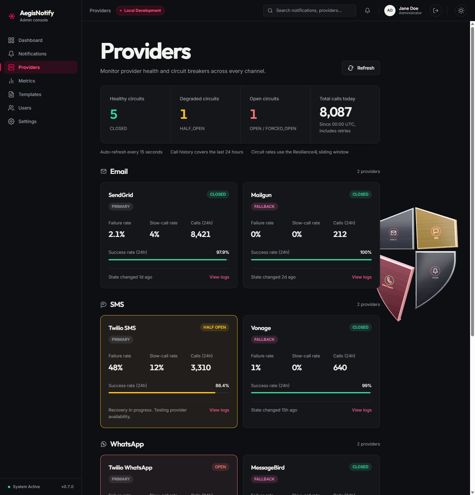

# Providers

[Manual index](README.md) | Previous: [Notifications](notifications.md) | Next: [Metrics](metrics.md)

## Purpose

A provider is an external service that actually delivers messages, for example an email or SMS
service. Each channel has a primary provider and a fallback provider. This screen shows how healthy
each one is, based on its circuit breaker and on recent call statistics.

Open it from **Providers** in the sidebar. The screen is read-only.

*Providers screen. (1) Refresh button. (2) Summary strip. (3) Notes on refresh and data window.
(4) Channel group with provider cards. Screenshots use sample data. The provider names, counts and
rates shown are illustrative.*

## Areas of the screen

### (1) Refresh

**Refresh** loads fresh data immediately. The screen also refreshes by itself every 15 seconds.
If a refresh fails after data was already shown, the screen keeps the last good data and shows
"Live update failed. Showing the last successful snapshot; provider states may have changed." with
a **Retry** button. If the first load fails it shows "Couldn't load provider health."

### (2) Summary strip

| Card | Meaning |
| --- | --- |
| **Healthy circuits** | Number of circuit breakers in the `CLOSED` state. |
| **Degraded circuits** | Number in the `HALF_OPEN` state (recovering, being tested). |
| **Open circuits** | Number in the `OPEN` or `FORCED_OPEN` state. |
| **Total calls today** | Calls to providers since 00:00 UTC. It includes automatic retries, so it can be higher than the number of notifications. |

### (3) Notes under the strip

"Auto-refresh every 15 seconds", "Call history covers the last 24 hours", and "Circuit rates use
the Resilience4j sliding window". Resilience4j is the software component that implements the
circuit breakers. The failure and slow-call rates are computed over the most recent calls, not over
24 hours. In the platform configuration the window is the last 10 calls.

### (4) Channel groups and provider cards

Providers are grouped under **Email**, **SMS**, **WhatsApp**, and **Push**, each with a provider
count. Within a group the primary provider is listed first. Each card shows:

| Item | Meaning |
| --- | --- |
| Provider name and role | The provider, and `PRIMARY` or `FALLBACK`. |
| State label (top right) | The circuit-breaker state, for example `CLOSED` or `HALF OPEN`. A fallback provider shows `NO CIRCUIT`, because it has no circuit breaker. |
| **Failure rate** | Share of recent calls that failed. Shows a dash until enough calls have been made to compute it. |
| **Slow-call rate** | Share of recent calls that were slower than the slow-call threshold (2 seconds in the platform configuration). Dash until enough calls have been made. |
| **Calls (24h)** | Calls made to this provider in the last 24 hours. |
| **Success rate (24h)** | Share of those calls that succeeded, with a bar: green at 95% or more, amber from 70% to below 95%, red below 70%. Reads "No calls" when there were none. |
| Status message | A sentence describing the state. For a closed circuit it reads "State changed 1d ago" (time since the last state change), or "No state change observed since service startup." |
| **View logs** | Opens the [Notifications](notifications.md) list filtered by this channel. |

The status messages for other states are:

| State | Message |
| --- | --- |
| `OPEN` | Circuit open, primary calls are routed to fallback. |
| `FORCED_OPEN` | Circuit forced open. Calls are blocked. |
| `HALF_OPEN` | Recovery in progress. Testing provider availability. |
| `NOT_PROTECTED` | Direct fallback, no circuit breaker configured. |
| `UNKNOWN` | Circuit state unavailable. |

The card border is colored to match: green for closed, amber for half-open, red for open.

If there are no providers the screen says "No providers available."; if a channel has none it says
"No providers configured for this channel."

## Actions

| Action | Result |
| --- | --- |
| **Refresh** | Reloads provider health now. |
| **View logs** on a card | Opens the Notifications list for that channel. |

## What to expect

- Several `OPEN` or `HALF_OPEN` cards together usually mean a provider outage rather than a problem
  with individual messages. See [Troubleshooting](troubleshooting.md#a-circuit-breaker-is-open).
- A circuit breaker opens automatically; you cannot open or close one from this screen.
- In the sample screenshot, the Twilio SMS card is `HALF OPEN` and the Twilio WhatsApp card is
  `OPEN`. This is sample data used to illustrate the states.
