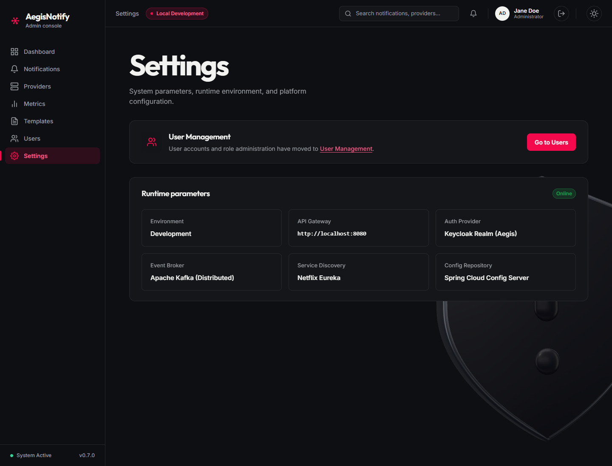

# Settings

[Manual index](README.md) | Previous: [Users and roles](users-and-roles.md) | Next: [Roles and permissions](roles-and-permissions.md)

## Purpose

The Settings screen shows information about the environment the console is connected to. It is
read-only: nothing on this screen can be edited, and it does not change how the platform behaves.

Open it from **Settings** in the sidebar.

*Settings screen. (1) User Management notice. (2) Runtime parameters. Screenshots use sample data.
The values shown are illustrative; yours depend on how the console was built and deployed.*

## Areas of the screen

### (1) User Management notice

A banner stating that user accounts and role administration have moved to the Users screen. The
**Go to Users** button and the link in the text both open [Users and roles](users-and-roles.md).

### (2) Runtime parameters

Six cards, plus an **Online** badge in the section heading.

| Card | Meaning |
| --- | --- |
| **Environment** | `Production` if the console was built as a production build, otherwise `Development`. |
| **API Gateway** | The gateway address the console was built with. If a deployment overrides the address at start-up through the console's `config.json` file, requests go to the overridden address and this card can differ from it. |
| **Auth Provider** | Fixed text: "Keycloak Realm (Aegis)". |
| **Event Broker** | Fixed text: "Apache Kafka (Distributed)". |
| **Service Discovery** | Fixed text: "Netflix Eureka". |
| **Config Repository** | Fixed text: "Spring Cloud Config Server". |

Only **Environment** and **API Gateway** come from the console's own build configuration. The other four
are descriptive labels written into the screen. The **Online** badge is also fixed text. It is not a
health check, so do not use it to decide whether the platform is working.

## Actions

None. The only controls are the links to the Users screen.

## What to expect

- **Environment** here can differ from the "Local Development" badge in the top bar, because the
  badge is fixed text. Treat the Settings value as the reliable one.
- If requests from the console fail, check that **API Gateway** shows the address you expect, and ask your administrator whether the deployment overrides it. See
  [Troubleshooting](troubleshooting.md#the-dashboard-is-empty-or-shows-errors).
