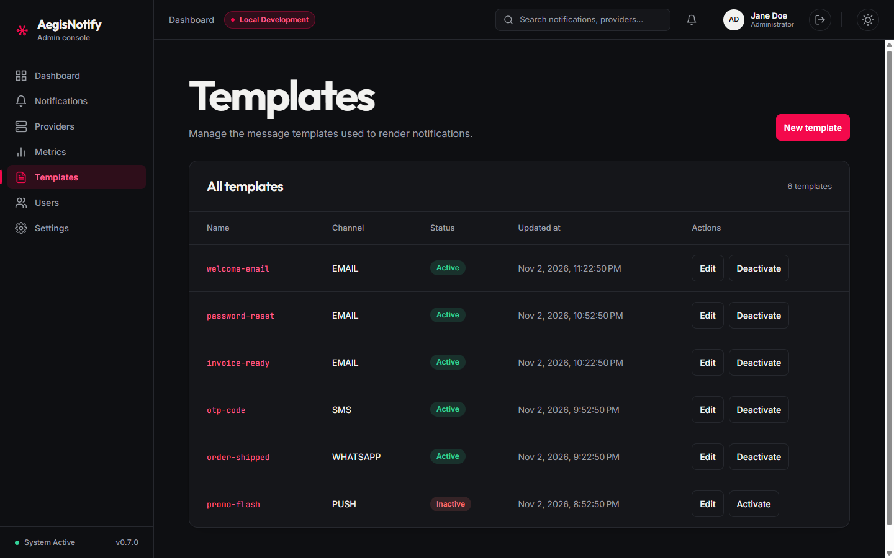
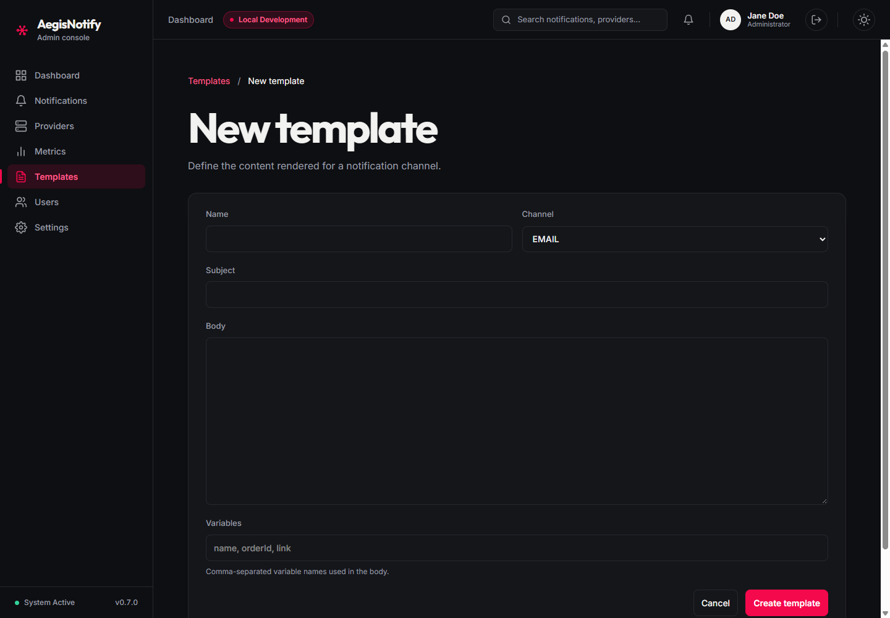
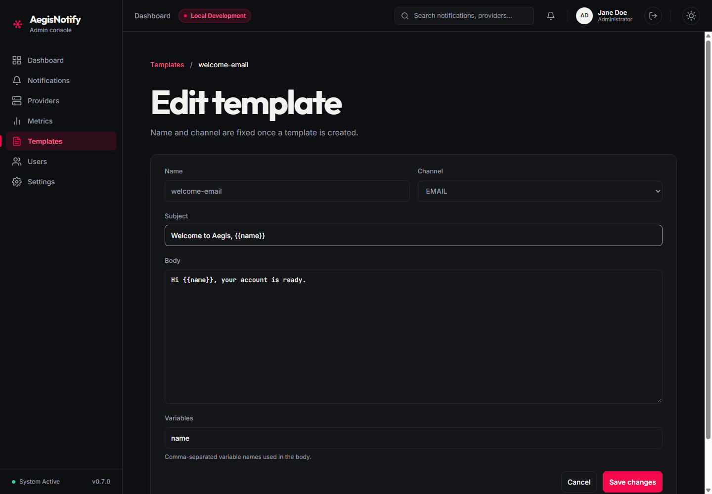

# Templates

[Manual index](README.md) | Previous: [Metrics](metrics.md) | Next: [Users and roles](users-and-roles.md)

## Purpose

A template defines the content of a message: an optional subject and a body with placeholders such
as `{{name}}`. When a notification is requested, it names a template, and the platform fills the
placeholders with the values supplied in the request. A notification can only be accepted if its
template exists and is active.

Open it from **Templates** in the sidebar.

## Template list

*Templates list. (1) New template button. (2) Templates table. (3) Row actions. Screenshots use
sample data. The template names shown are illustrative.*

**(1) New template** opens the [creation form](#creating-a-template).

**(2) Table.** The heading shows the number of templates, for example "6 templates".

| Column | Meaning |
| --- | --- |
| **Name** | The template name. This is the value a notification request uses to select the template. Select it to edit. |
| **Channel** | `EMAIL`, `SMS`, `WHATSAPP`, or `PUSH`. |
| **Status** | `Active` (green) or `Inactive` (red). |
| **Updated at** | When the template was last changed. |
| **Actions** | **Edit**, and **Deactivate** or **Activate**. |

**(3) Row actions**

| Action | Result |
| --- | --- |
| **Edit** | Opens the [edit form](#editing-a-template). |
| **Deactivate** | Marks the template inactive. The change is applied immediately, with no confirmation dialog. |
| **Activate** | Marks an inactive template active again. Also immediate. |

While a status change is in progress the button on that row is disabled. If it fails, a message
reads "Couldn't update <name>. Please try again." If there are no templates the screen says "No
templates yet", and if loading fails it shows "Couldn't load templates" with **Retry**.

An inactive template is kept but cannot be used for new notifications: a request that names an
inactive template is rejected as if the template did not exist (HTTP 404).

## Creating a template

*New template form. (1) Breadcrumb. (2) Name and Channel. (3) Subject. (4) Body. (5) Variables.
(6) Cancel and Create template. Screenshots use sample data.*

| Field | Required | Meaning |
| --- | --- | --- |
| **Name** | Yes | Unique name, up to 255 characters. Cannot be changed later. |
| **Channel** | Yes | Channel the template is written for. Defaults to `EMAIL`. Cannot be changed later. |
| **Subject** | No | Subject line, up to 255 characters. Mainly meaningful for email. |
| **Body** | Yes | The message text. Write placeholders as `{{variableName}}`. |
| **Variables** | No | Comma-separated list of the placeholder names the body uses, for example `name, orderId, link`. Blank entries and duplicates are ignored. |

The **Variables** list is the list of values a notification request must supply. If a request for
this template is missing any listed variable, the message cannot be rendered and the platform
reports the missing names. List every variable that your body needs.

Steps:

1. Select **New template** on the Templates list.
2. Fill in **Name**, choose the **Channel**, and write the **Body**. Add a **Subject** and
   **Variables** if needed.
3. Select **Create template**.

Result: you return to the list and the new template appears as `Active`. If the name is already
used, the form shows `A template named "<name>" already exists.` If a required field is empty it
shows "Name, channel and body are required." Select **Cancel** to leave without saving.

## Editing a template

*Edit template form. The Name and Channel fields are fixed. Screenshots use sample data.*

Select **Edit** (or the template name) on the list. The page reads "Name and channel are fixed once
a template is created." You can change the **Subject**, **Body**, and **Variables**. Select **Save
changes** to apply them and return to the list, or **Cancel** to discard.

To change a name or channel, create a new template and deactivate the old one.

If the template no longer exists the page shows "Template not found".

## What to expect

- Changes to the body take effect for messages rendered after the change.
- Deactivating a template does not remove it. The platform looks the active template up again when
  it processes each notification, so a notification that was accepted before you deactivated its
  template, but is processed after, fails with a "template not found" error and is not delivered.
  Do not deactivate a template while notifications that use it are still waiting. The status such a
  notification ends up showing was not verified for this manual.
- If notifications fail because of a template, see
  [Troubleshooting](troubleshooting.md#a-template-is-not-found-or-is-inactive).
