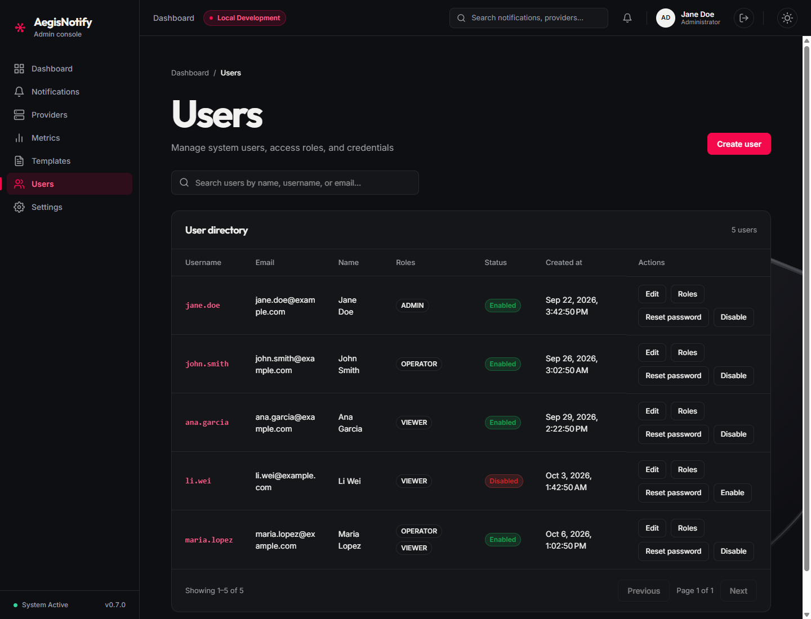
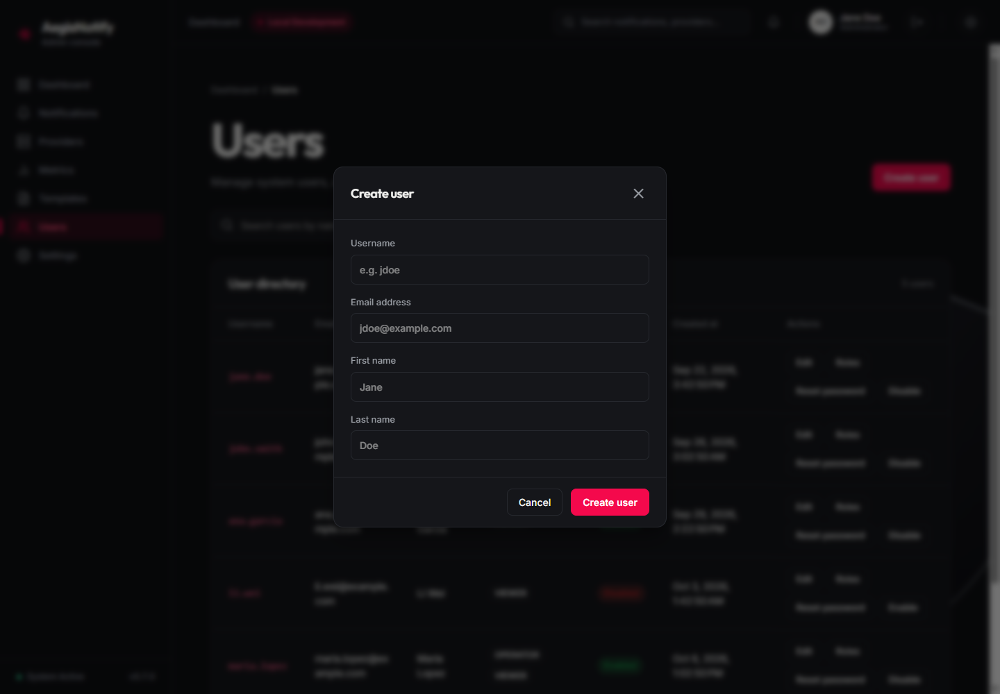
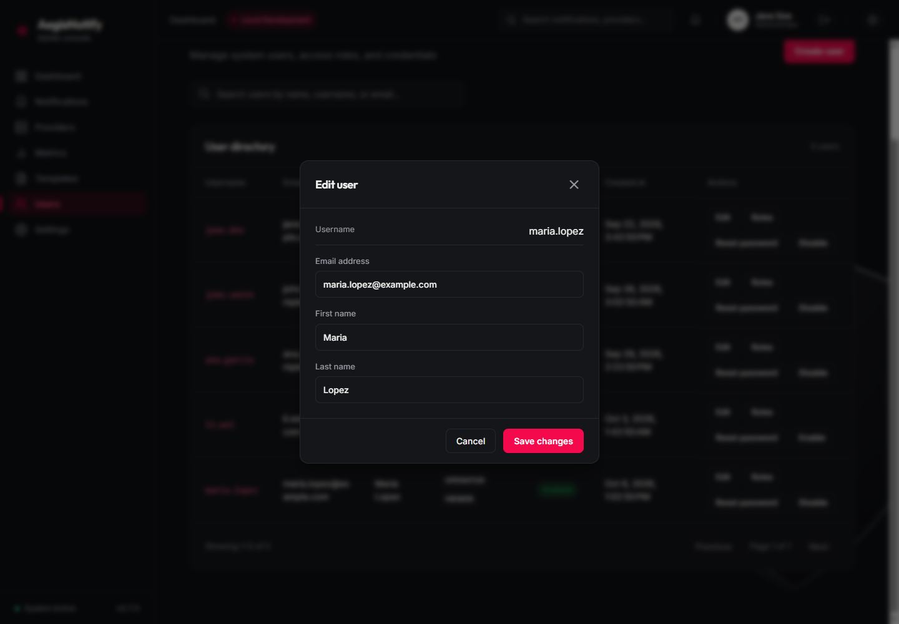
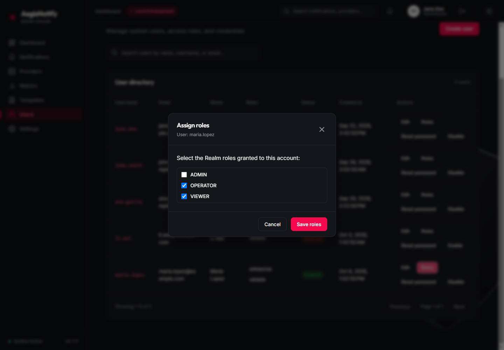
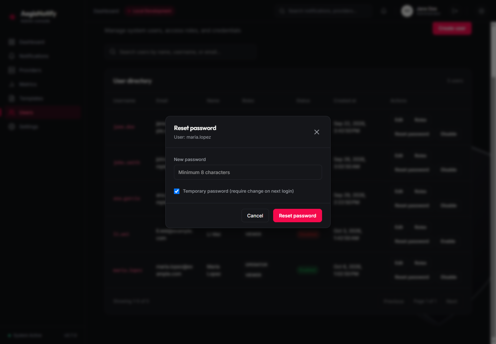

# Users and roles

[Manual index](README.md) | Previous: [Templates](templates.md) | Next: [Settings](settings.md)

## Purpose

This screen manages the user accounts that can sign in to AegisNotify. User accounts and roles are
stored in Keycloak, the identity provider. The console talks to a user service, which in turn
calls Keycloak on your behalf.

Open it from **Users** in the sidebar. The older "User Management" section of Settings now links
here.

> **Roles and access.** The roles you assign here are Keycloak realm roles. In the platform source
> and in the supplied Keycloak realm file, API access is decided by OAuth2 scopes, not by these
> roles. Read [Roles and permissions](roles-and-permissions.md) before relying on a role to
> restrict anyone's access. The role names in the screenshots (`ADMIN`, `OPERATOR`, `VIEWER`) are
> sample data.

## User list

*Users screen. (1) Create user button. (2) Search box. (3) User directory table. (4) Row actions.
(5) Pagination. Screenshots use sample data. The names, emails and roles shown are illustrative.*

**(1) Create user** opens the [Create user](#creating-a-user) dialog.

**(2) Search.** Type part of a name, username, or email. The list updates automatically about
0.3 seconds after you stop typing and returns to the first page. The **x** button inside the box
clears the search. With no match the screen reads `No users match "<text>"`.

**(3) User directory.** The heading shows the total ("5 users"). The page size is 20.

| Column | Meaning |
| --- | --- |
| **Username** | The sign-in name. |
| **Email** | Email address. |
| **Name** | First and last name. |
| **Roles** | The realm roles assigned to the user, one chip per role. A dash means none. |
| **Status** | `Enabled` or `Disabled`. A disabled user cannot sign in. |
| **Created at** | When the account was created. |
| **Actions** | **Edit**, **Roles**, **Reset password**, and **Disable** or **Enable**. |

**(5) Pagination.** "Showing 1–5 of 5", **Previous**, "Page 1 of 1", **Next**.

If loading fails the screen shows "Couldn't load users" with **Retry**.

## Actions

Each dialog closes with the **x** button at its top right or with **Cancel**. Clicking outside the
dialog also closes it. Closing a dialog discards what you typed.

### Creating a user

*Create user dialog. (1) Close. (2) Fields. (3) Cancel and Create user. Screenshots use sample
data.*

| Field | Rules |
| --- | --- |
| **Username** | Required, up to 255 characters. |
| **Email address** | Required, must be a valid email, up to 320 characters. |
| **First name** | Required, up to 255 characters. |
| **Last name** | Required, up to 255 characters. |

Select **Create user**. The dialog closes and the list reloads from the first page. If a user with
the same username or email already exists, the dialog shows "A user with that username or email
already exists." Other failures show "Couldn't create the user. Please try again." If a field is
missing or the email is invalid, it shows "All fields are required and email must be valid."

The dialog does not ask for a password and does not assign roles. After creating the user, use
**Reset password** to set a first password and **Roles** to assign roles.

### Editing a user

*Edit user dialog. The username is shown but cannot be changed. Screenshots use sample data.*

Select **Edit** on the user's row. You can change **Email address**, **First name**, and
**Last name**. The username is fixed. Select **Save changes**. On failure the dialog shows
"Couldn't update user details. Please try again."

### Assigning roles

*Assign roles dialog for one user. (1) The user being edited. (2) Checklist of realm roles.
(3) Cancel and Save roles. Screenshots use sample data. The role names are illustrative.*

Select **Roles** on the user's row. The dialog lists every realm role that exists in Keycloak, with
the user's current roles ticked. Tick or untick roles and select **Save roles**. The user's roles
become exactly the ticked set: unticked roles are removed.

If the list is empty the dialog reads "No available realm roles found in Keycloak." Roles are
created in Keycloak, not in this console. If saving fails the dialog shows "Couldn't update user
roles. Please try again."

### Resetting a password

*Reset password dialog. (1) New password. (2) Temporary password checkbox. (3) Cancel and Reset
password. Screenshots use sample data.*

Select **Reset password** on the user's row.

| Field | Meaning |
| --- | --- |
| **New password** | Required, at least 8 characters. Otherwise the dialog says "Password must be at least 8 characters." |
| **Temporary password (require change on next login)** | Ticked by default. When ticked, the user is required to choose a new password the next time they sign in. Untick it to set a permanent password. |

Select **Reset password**. On success the dialog closes. There is no confirmation message. On failure it shows "Couldn't reset the password. Please try again." The
console does not show or send the password to anyone, so pass it to the user through a secure
channel.

### Disabling and enabling a user

Select **Disable** on an enabled user's row, or **Enable** on a disabled user's. The change applies
immediately, with no confirmation dialog, and the list reloads. The button is unavailable while the
change is in progress. If it fails, a message reads "Couldn't update status for <username>. Please
try again."

There is no option to delete a user. Disabling an account is the way to remove someone's access.

## What to expect

- A new user is created as `Enabled` and without a password. The console assigns no roles at
  creation. Keycloak itself may attach default roles, depending on how the realm is configured.
- Role changes appear in the **Roles** column after the list reloads.
- If the whole screen fails to load, see [Troubleshooting](troubleshooting.md#users-screen-fails-to-load-or-saving-a-user-fails).
